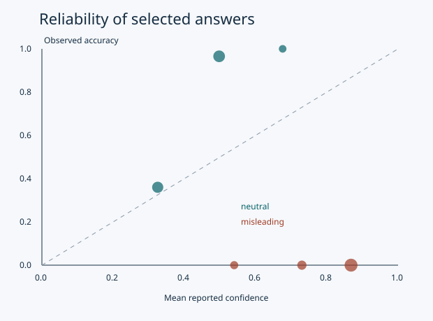

# Can a Model Tell When It’s Wrong?

How does misleading context affect a learned model’s accuracy and confidence? This paired experiment varies one line in each controlled prompt. It uses a four-choice arithmetic softmax model with rounded-arithmetic distance and hint-match features. The exact solver gives a reference for interpreting the fixtures.

## Results

| Condition | Correct | Mean confidence | Brier score |
|---|---:|---:|---:|
| Neutral | 43/60 | 44.36% | 0.2285 |
| Misleading | 0/60 | 79.43% | 0.6455 |

43 pairs switched from correct to wrong and zero switched the other way. On 40 + 22, the model switched to the misleading answer of 57 and gave it 79.36% confidence. The exact solver answered every pair correctly. See the full paired CSV and summary JSON in `results/`.

## Run locally

With Python 3.11 or later, run `python -m unittest -v` and `python study.py`. The script recreates the CSV, JSON and SVG in `results/`. No dependencies or paid keys are required. The data are generated arithmetic fixtures, with answer keys cross-checked by a separate implementation.

The technical decision is to explain confidence as the softmax probability of the selected option. Training hints usually point to the correct answer, which creates a controlled shortcut. The misleading condition shifts that relationship. The observed effect concerns this arithmetic model and generator. Discuss how the train/test split matters, when the exact solver is appropriate, and why Brier score differs from accuracy.

Neil Meher specified the matched-pair question and evaluation requirements. Codex implemented and ran the experiment. Neil's independent walkthrough is pending.
